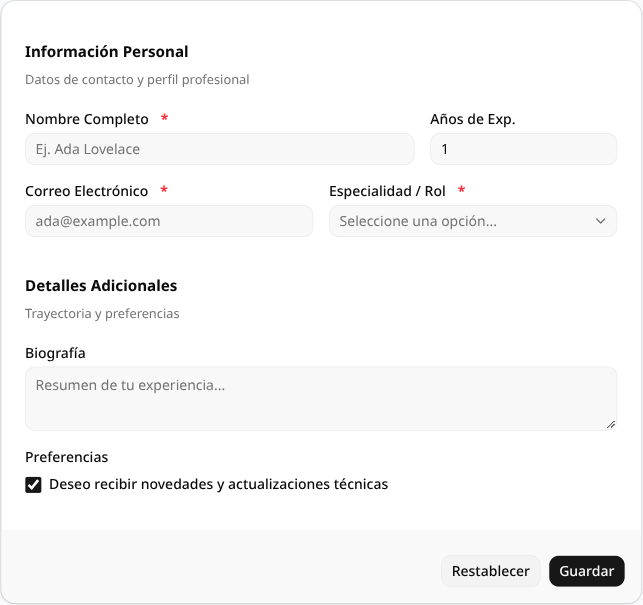
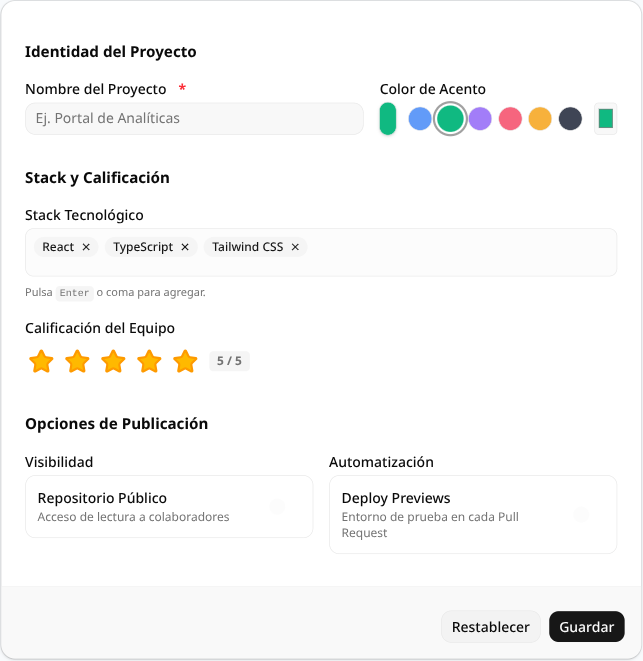
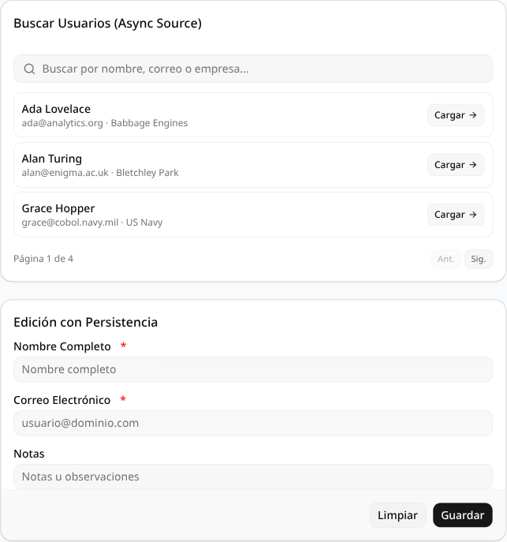

# Ejemplos de microform

Colección de ejemplos prácticos y listos para ejecutar construidos con **React 19**, **Vite**, **Tailwind CSS v4** y componentes oficiales de **shadcn/ui** configurados vía `components.json`.

Cada ejemplo es un proyecto completamente independiente con su propio `package.json`, consumiendo la versión publicada de `microform` directamente desde GitHub:

```json
"dependencies": {
  "microform": "github:microx-technologies/microform#v0.2.1"
}
```

---

## Galería de Ejemplos

### [01. Formulario Básico (`examples/01-basic-form`)](./01-basic-form)

Demuestra los fundamentos de `microform`:
* Inferencia de valores por defecto desde esquemas Zod con `createFormDefaults`.
* Inferencia de campos requeridos con `buildRequiredMap`.
* Maquetación declarativa mediante grid de 12 columnas con secciones (`FieldSection`) y filas (`FieldRow`).
* Controles base (`text`, `email`, `number`, `textarea`, `select`, `checkbox`) estilizados con componentes oficiales de shadcn/ui.

<p align="center">
  
</p>

```bash
cd examples/01-basic-form
bun install
bun run dev
```

---

### [02. Controles Personalizados y OCP (`examples/02-custom-controls`)](./02-custom-controls)

Demuestra el principio **Open/Closed (OCP)** en su máxima expresión: **abierto a extensión, cerrado a modificación**.
* Nuevos controles creados en espacio de usuario con `defineControl` sin modificar el código fuente de `microform`:
  * **Rating (1-5 estrellas)**: Interactivo con hover, estados y badge.
  * **Tag Input**: Entrada de chips/badges con teclado (Enter, coma, Backspace).
  * **Switch Toggle**: Encapsulación del componente `Switch` de shadcn con título y subtítulo.
  * **Color Picker**: Selector de paleta de colores y valor hexadecimal.
* Registro dinámico mediante `createMicroform({ controls: [...] })`.
* Cero `any`: Tipado estricto y seguro de extremo a extremo.

<p align="center">
  
</p>

```bash
cd examples/02-custom-controls
bun install
bun run dev
```

---

### [03. Puertos Asíncronos y Persistencia (`examples/03-async-ports-persistence`)](./03-async-ports-persistence)

Demuestra la **Arquitectura Hexagonal (Puertos y Adaptadores)**:
* **`StorageAdapter` real**: Implementación sobre `window.localStorage` conectada a `usePersistence` para auto-guardar y restaurar borradores en vivo.
* **`QuerySource` asíncrono**: Búsqueda remota con debounce (200ms), paginación de servidor y cancelación con `AbortSignal` vía `useAsyncQuery`.
* **`NotifyAdapter`**: Sistema reactivo de notificaciones Toast interactivo.
* **Submit Flow**: Orquestación del ciclo de vida con `handleSubmitFlow`, manejo de mutaciones asíncronas (`MutationPort`) y limpieza del almacenamiento local.

<p align="center">
  
</p>

```bash
cd examples/03-async-ports-persistence
bun install
bun run dev
```
